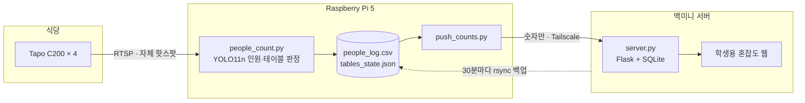

# 밥먹을래말래 · 카메라 기반 학내 식당 실시간 혼잡도 안내 시스템

학생회관 1층 식당에 카메라 4대를 달고, 라즈베리파이 5가 현장에서 YOLO로 **사람 수와 테이블별 사용 여부만 숫자로** 서버에 보냅니다. 서버는 **점유 테이블의 좌석과 전체 인원을 함께 보고 지금 혼잡도(여유 · 보통 · 혼잡)를 판단**하고, **지난 평일 기록으로 시간대별 평소 인원**을 함께 보여줍니다. 영상은 저장하거나 전송하지 않습니다.

- 팀: 이승원 · 팀원 (순천향대학교 컴퓨터공학과 3학년 캡스톤디자인)
- 설치: 2026-10-21 학생회관 1층 식당 · 시범 운영 2026-10-20 ~ 11-05, 평일 08:00–19:30
- **공개 주소: https://babmeok.tail976ee0.ts.net** (10/29부터, 교수님 승인)

## 해결하려는 문제

- 점심시간에 학생이 한꺼번에 몰리지만, 가기 전에는 얼마나 붐비는지 알 수 없다.
- 학생식당은 예약·좌석 배정이 없어 실시간 좌석 정보를 얻을 방법이 없다.

그래서 두 가지 질문에 답합니다.

1. **"지금 가면 앉을 수 있나?"** → 실시간 혼잡도, 빈 테이블 수, 자리 배치도
2. **"평소엔 언제 붐비나?"** → 하루 시간대별 오늘 인원과 평소(지난 평일 평균) 비교 그래프

## 전체 흐름



1. **카메라 → 라즈베리파이** — 카메라 4대가 라즈베리파이가 직접 띄운 2.4GHz 핫스팟에 붙어 RTSP로 영상을 보낸다. 영상이 학교 네트워크로 나가지 않는다.
2. **인원·테이블 판정** — 카메라별 최신 프레임을 모아 YOLO11n(NCNN, 입력 1280)으로 사람을 찾고, **발 위치가 집계 구역 안인 사람만** 센다. 등록한 테이블 영역 안에 사람이 있으면 그 테이블을 "사용 중", 잠깐 비면 "자리 비움", 오래 비면 "빈 자리"로 판정한다. 영상은 메모리에서만 쓰고 버린다.
3. **전송** — 5초마다 새 기록과 테이블 상태를 Tailscale을 통해 서버로 보낸다. 끊기면 보낸 위치를 기억했다가 이어서 보낸다.
4. **서버** — SQLite에 저장하고, `사용 좌석 = max(점유 테이블 좌석 합, 전체 인원)`으로 남은 좌석 비율을 구해 혼잡 단계를 ([계산 방법](혼잡도-계산.md)), 지난 평일 같은 15분 칸 평균으로 "평소" 값을 계산한다.
5. **웹** — "지금 가면" 혼잡 단계 · 빈 테이블 수 · 식당 예상 인원 · 키오스크 대기 · 시간대별 그래프 · 자리 배치도를 보여준다.

### 설계 원칙

- **엣지 처리** — 영상은 현장에서 처리하고 숫자만 내보낸다 (개인정보 보호 + 네트워크 절약)
- **역할 분리** — 라즈베리파이는 "세기", 서버는 "저장 · 판단 · 보여주기"
- **끊겨도 안 잃기** — CSV 우선 기록, 이어 보내기, 중복 자동 무시, 30분마다 백업
- **자동 복구** — 모든 프로그램이 부팅 시 자동 시작, 죽으면 자동 재시작

## 사용 기술

| 분야 | 기술 | 이유 |
|---|---|---|
| 카메라 | Tapo C200 × 4, RTSP | 저렴하고 표준 방식으로 영상 수신 가능 |
| 엣지 장치 | Raspberry Pi 5 (8GB) | 현장에서 카메라 4대를 처리하는 저전력 컴퓨터 |
| 사람 검출 | YOLO11n (Ultralytics), 입력 1280 | 가장 작은 YOLO라 CPU에서 동작, 해상도를 올려 작게 찍힌 사람까지 검출 |
| 모델 실행 | NCNN (실패 시 ONNX + OpenCV DNN) | ARM CPU용 엔진으로 OpenCV DNN보다 약 2배 빠름, 결과는 동일 |
| 영상 처리 | OpenCV (Python) | RTSP 수신, NMS, 구역·테이블 판정 |
| 현장 관리 웹 | Flask, MJPEG | 카메라 화면 확인, 집계 구역 · 테이블 영역 설정 |
| 전송 | HTTP POST + API 키 (urllib) | 외부 라이브러리 없이 숫자만 전송 |
| 원격 접속 | Tailscale (WireGuard VPN) | Wi-Fi가 바뀌어도 고정 주소, 포트 개방 불필요 |
| 서버 | Flask + gunicorn | 가벼운 Python 웹 서버 |
| 저장소 | SQLite (WAL) | 별도 DB 서버 없이 파일 하나로 저장 |
| 웹 화면 | HTML / CSS / JavaScript | PC · 모바일 반응형, 밝은/어두운 화면, 그래프 라이브러리 없이 직접 그림 |
| 네트워크 | NetworkManager, dnsmasq | 카메라 전용 핫스팟, 카메라 IP 고정, 인터넷은 USB 무선랜 동글로 분리 |
| 자동 실행 | systemd, launchd | 부팅 시 시작, 장애 시 재시작 |
| 백업 | rsync + SSH 키 | 30분마다 변경분만 복사 |

## 저장소 구성 — 어떤 파일이 무엇인가

```
microprocessor/
├── README.md                 프로젝트 소개 (이 문서)
├── cafeteria-server/         ▶ 맥미니에서 도는 서버와 학생용 웹       → cafeteria-server/README.md
├── pi/                       ▶ 라즈베리파이에서 도는 인원 계산·전송    → pi/README.md
├── 혼잡도-계산.md             팀원이 정리한 혼잡도 계산 방법 (지금 서버에 적용된 식의 근거)
├── docs/
│   ├── HANDOFF.md            인수인계·발표 대비 (운영 매뉴얼, 변경 이력, 발표 Q&A) ← 가장 자세함
│   ├── 주소.md                웹·통계·관리 화면·SSH 주소 모음 (팀원용)
│   ├── 발표_준비.md           11/3 학술제 발표 준비 체크리스트 (교수님 피드백, 포스터 이후 바뀐 점)
│   ├── 혼잡도_판단_방식.md    여유·보통·혼잡을 정하는 계산식, 바뀐 과정, 실제 기록 비교
│   ├── 프로젝트_상세.md       10/22 시점 상세 설명 (구조·네트워크·판단 논리)
│   └── 진행기록/              주제 회의(09/03) ~ 파이 세팅(10/14) 기록 01 ~ 09
└── 화면설계/디자인후보/        웹 디자인 후보 5종 비교와 확정 화면 캡처
```

| 파일 | 하는 일 | 실제로 도는 곳 |
|---|---|---|
| [cafeteria-server/server.py](cafeteria-server/server.py) | 라즈베리파이 데이터 받기·저장, 혼잡 단계 판단, 시간대별 평소 값 계산 (API) | 맥미니 `:8000` |
| [cafeteria-server/index.html](cafeteria-server/index.html) | 학생용 혼잡도 웹 화면 (그래프·배치도 포함 한 파일) | 맥미니 `:8000/` |
| [cafeteria-server/backup_pi.sh](cafeteria-server/backup_pi.sh) | 라즈베리파이 기록을 맥미니로 30분마다 백업 | 맥미니 (launchd) |
| [cafeteria-server/launchd/](cafeteria-server/launchd/) | 서버·백업 자동 실행 설정 | 맥미니 |
| [pi/people_count.py](pi/people_count.py) | 카메라 수신 → YOLO 인원 계산 → 테이블 판정 → 기록, 현장 관리 화면 | 라즈베리파이 `:5000` |
| [pi/push_counts.py](pi/push_counts.py) | 기록을 맥미니로 5초마다 전송 | 라즈베리파이 (systemd) |
| [pi/tables.json](pi/tables.json) · [pi/zones.json](pi/zones.json) | 테이블 영역 51곳 · 카메라별 집계 구역 (관리 화면에서 저장한 값) | 라즈베리파이 |

**저장소 코드와 실제 기기 코드의 차이:** 카메라 IP · RTSP 비밀번호 · Tailscale IP는 저장소에서 `<cam1 IP>` 같은 자리 표시로 가렸습니다. 그래서 **저장소 파일을 기기에 그대로 덮어쓰면 안 됩니다.** 고친 내용을 기기에 반영하는 방법은 [HANDOFF 14장 "코드 수정 반영"](docs/HANDOFF.md#코드-수정-반영-저장소--기기)에 있습니다.

## 진행 과정

| 시기 | 내용 |
|---|---|
| 9월 초 | 주제 회의 → "학내 식당 혼잡도 안내"로 확정 |
| 9/21 | 설계 변경 — 입구 LED 신호등 · IR 센서 폐기, 카메라 + 웹 단일 채널로 단순화 |
| 10/3 | 구현 계획 — 카메라 · 라즈베리파이 핫스팟 · 서버 · 예측 구조 확정 |
| 10/14 | 라즈베리파이 + 카메라 1대 연결, 자체 핫스팟 구성, YOLO11n 인원 추론 첫 동작 |
| 10/20~21 | 식당 설치, 1280 모델 · 1080p로 설정 확정, 맥미니 서버 · 웹 · 백업 운영 시작 |
| 10/22 | 카메라 4대로 확장 |
| 10/27 | 추론 엔진 NCNN 교체 (약 2배 빠름) → 피크 3초 / 평상시 5초 주기 |
| 10/28~29 | 테이블 51곳 영역 등록 · 자리별 판정 적용, 혼잡 단계를 테이블 좌석 + 인원 기준으로 변경, 웹 디자인 확정, 자리비움 오탐 수정, 관리 화면 디자인 통일 |

## 한계와 다음 단계

- 테이블 판정은 "영역 안에 사람이 있는가"로만 정한다. 줄 서거나 지나가는 사람이 영역을 스치면 잠깐 사용 중으로 보일 수 있다.
- 위에서 본 각도라 앉은 사람을 놓치기도 하고, 1인석 9자리와 야외 테이블은 카메라 밖이라 집계하지 않는다.
- 다음 단계: 실제 인원과 비교한 정확도 평가, 현장 관찰로 혼잡 기준 보정, "평소" 값에서 설치 첫날(10/21) 기록 제외 검토.

## 문서

- **[docs/주소.md](docs/주소.md)** — 주소 모음: 공개 웹, 팀용 통계, 카메라 관리 화면, SSH, 자주 쓰는 명령 (팀원 참고용)
- **[docs/발표_준비.md](docs/발표_준비.md)** — 11/3 발표 준비: 교수님 피드백 대응, 할 일 체크리스트, 포스터 이후 바뀐 점, 일정
- **[docs/HANDOFF.md](docs/HANDOFF.md)** — 인수인계 · 운영 매뉴얼 · 설정 변경 이력 · 겪은 문제 · 발표 예상 질문 (가장 최신)
- **[docs/혼잡도_판단_방식.md](docs/혼잡도_판단_방식.md)** — 혼잡 단계 계산식이 어떻게 바뀌었는지, 지금 식과 코드 위치, 10/29 기록 비교
- [혼잡도-계산.md](혼잡도-계산.md) — 테이블 점유와 전체 인원으로 빈 좌석·혼잡 단계를 구하는 방법 (팀원 정리, 10/29 서버에 적용)
- [docs/프로젝트_상세.md](docs/프로젝트_상세.md) — 10/22 시점 하드웨어 · 네트워크 · 판단 논리 상세

### 진행 기록

주제 선정부터 라즈베리파이 세팅까지 작성 당시의 기록입니다. 설계가 어떻게 바뀌어 왔는지 볼 수 있습니다.

| # | 날짜 | 문서 | 내용 |
|---|---|---|---|
| 1 | 09/03 | [주제 회의](docs/진행기록/01_주제회의_0903.md) | 주제 후보 도출 |
| 2 | 09/07 | [주제 확정](docs/진행기록/02_주제확정_0907.md) | 식당 혼잡도로 주제 확정, 초기 설계 |
| 3 | 09/10 | [신청서 요약서](docs/진행기록/03_신청서_요약서_0910.md) | 과제 신청서 제출본 |
| 4 | 09/14 | [과제 확정](docs/진행기록/04_과제확정_0914.md) | 측정 대상을 좌석 점유로, 출력을 혼잡도 3단계로 확정 |
| 5 | 09/14 | [실행 계획](docs/진행기록/05_실행계획_0914.md) | 정확도 확보 방법 · 로드맵 |
| 6 | 09/16 | [예산 회의](docs/진행기록/06_예산회의_0916.md) | 부품 · 예산 검토 |
| 7 | 09/21 | [설계 변경](docs/진행기록/07_설계변경_0921.md) | 입구 LED · IR 센서 폐기, 웹 단일 채널 |
| 8 | 10/03 | [구현 계획](docs/진행기록/08_구현계획_1003.md) ([PDF](docs/진행기록/08_구현계획_1003.pdf)) | 카메라 · 라즈베리파이 핫스팟 · 서버 · 예측 구조 |
| 9 | 10/14 | [파이 세팅](docs/진행기록/09_파이세팅_1014.md) | 라즈베리파이 · 카메라 · 핫스팟 세팅, 첫 인원 추론 |
