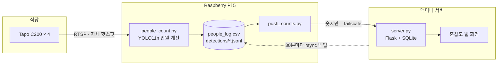

# 밥먹을래말래 · 카메라 기반 학내 식당 실시간 혼잡도 안내 시스템

학생회관 1층 식당에 카메라 4대를 달고, 라즈베리파이 5가 현장에서 YOLO로 **사람 수만 세어 숫자로** 서버에 보냅니다. 서버는 **좌석 수 대비 인원으로 혼잡도(여유 · 보통 · 혼잡)를 판단**하고, **지난 평일 기록으로 시간대별 혼잡을 예측**해 웹으로 보여줍니다. 영상은 저장하거나 전송하지 않습니다.

- 팀: 이승원 · 팀원 (순천향대학교 컴퓨터공학과 캡스톤디자인)
- 설치: 2026-10-21 학생회관 1층 식당 · 데이터 수집 2026-10-20 ~ 11-05

## 해결하려는 문제

- 점심시간에 학생이 한꺼번에 몰리지만, 가기 전에는 얼마나 붐비는지 알 수 없다.
- 학생식당은 예약·좌석 배정이 없어 실시간 좌석 정보를 얻을 방법이 없다.

그래서 두 가지 질문에 답합니다.

1. **"지금 가면 앉을 수 있나?"** → 실시간 혼잡도
2. **"언제 가면 덜 붐비나?"** → 15분 단위 시간대별 예측

## 전체 흐름



1. **카메라 → 라즈베리파이** — 카메라 4대가 라즈베리파이가 직접 띄운 2.4GHz 핫스팟에 붙어 RTSP로 영상을 보낸다. 영상이 학교 네트워크로 나가지 않는다.
2. **인원 계산** — 카메라별 최신 프레임을 모아 YOLO11n(입력 1280)으로 사람을 찾고, NMS로 중복을 지운 뒤 **발 위치가 집계 구역 안에 있는 사람만** 센다. 최근 15초 값의 75퍼센타일로 깜빡임을 보정해 CSV에 기록한다. 영상은 메모리에서만 쓰고 버린다.
3. **전송** — 5초마다 CSV의 새 줄만 Tailscale을 통해 서버로 보낸다. 끊기면 보낸 위치를 기억했다가 이어서 보낸다.
4. **서버** — SQLite에 저장하고, 좌석 수 대비 인원으로 혼잡 단계를, 지난 평일 같은 15분 칸 평균으로 예측을 계산한다.
5. **웹** — "지금 가면" 혼잡 단계 · 현재 인원 · 추세 · 덜 붐비는 시간 추천 · 점심/저녁 예측 그래프를 보여준다.

### 설계 원칙

- **엣지 처리** — 영상은 현장에서 처리하고 숫자만 내보낸다 (개인정보 보호 + 네트워크 절약)
- **역할 분리** — 라즈베리파이는 "세기", 서버는 "저장 · 판단 · 보여주기"
- **끊겨도 안 잃기** — CSV 우선 기록, 이어 보내기, 중복 자동 무시, 30분마다 백업
- **자동 복구** — 모든 프로그램이 부팅 시 자동 시작, 죽으면 자동 재시작

## 사용 기술

| 분야 | 기술 | 이유 |
|---|---|---|
| 카메라 | Tapo C200 × 4, RTSP | 저렴하고 표준 방식으로 영상 수신 가능 |
| 엣지 장치 | Raspberry Pi 5 (8GB) | 현장에서 카메라 4대를 처리하는 저전력 컴퓨터 |
| 사람 검출 | YOLO11n (Ultralytics), 입력 1280 | 가장 작은 YOLO라 CPU에서 동작, 해상도를 올려 작게 찍힌 사람까지 검출 |
| 모델 실행 | ONNX + OpenCV DNN | PyTorch 없이 OpenCV만으로 추론, 설치가 가볍고 안정적 |
| 영상 처리 | OpenCV (Python) | RTSP 수신, NMS, 구역 판정 |
| 현장 관리 웹 | Flask, MJPEG | 카메라 화면 확인, 집계 구역 · 테이블 영역 설정 |
| 전송 | HTTP POST + API 키 (urllib) | 외부 라이브러리 없이 숫자만 전송 |
| 원격 접속 | Tailscale (WireGuard VPN) | Wi-Fi가 바뀌어도 고정 주소, 포트 개방 불필요 |
| 서버 | Flask + gunicorn | 가벼운 Python 웹 서버 |
| 저장소 | SQLite (WAL) | 별도 DB 서버 없이 파일 하나로 저장 |
| 웹 화면 | HTML / CSS / JavaScript | PC · 모바일 반응형, 그래프 라이브러리 없이 직접 그림 |
| 네트워크 | NetworkManager, dnsmasq | 카메라 전용 핫스팟, 카메라 IP 고정, 인터넷은 USB 무선랜 동글로 분리 |
| 자동 실행 | systemd, launchd | 부팅 시 시작, 장애 시 재시작 |
| 백업 | rsync + SSH 키 | 30분마다 변경분만 복사 |

## 진행 과정

| 시기 | 내용 |
|---|---|
| 9월 초 | 주제 회의 → "학내 식당 혼잡도 안내"로 확정 |
| 9/21 | 설계 변경 — 입구 LED 신호등 · IR 센서 폐기, 카메라 + 웹 단일 채널로 단순화 |
| 10/3 | 구현 계획 — 카메라 · 라즈베리파이 핫스팟 · 서버 · 예측 구조 확정 |
| 10/7 | 카메라 · 케이블 몰딩 · 방열 케이스 구매 |
| 10/14 | 라즈베리파이 + 카메라 1대 연결, 자체 핫스팟 구성, YOLO11n 인원 추론 첫 동작 |
| 10/20~21 | 식당 설치, 1280 모델 · 1080p로 설정 확정, 맥미니 서버 · 웹 · 백업 운영 시작 |
| 10/22 | 카메라 4대로 확장, 추론 주기 조정 (피크 6초 / 평상시 8초) |
| 진행 중 | 집계 구역 · 실제 좌석 수 반영, 테이블 단위 빈자리 판정, 정확도 · 예측 오차 평가 |

## 한계와 다음 단계

- 지금은 빈자리를 `좌석 수 − 인원`으로 **추정**한다. 4인 테이블에 2명만 앉아도 사실상 꽉 찬 것처럼 쓰이는 등 실제와 차이가 있다.
- 줄 선 사람 · 지나가는 사람도 세고, 위에서 본 각도라 앉은 사람을 놓치기도 한다.
- 다음 단계: 사람별 좌표 기록을 이용한 **테이블 단위 판정**, 줄 서는 구역 제외, 현장 관찰로 혼잡 기준 보정, 실제 인원과 비교한 정확도 평가.

## 문서

**→ [프로젝트 상세 문서](docs/프로젝트_상세.md)** — 하드웨어 · 네트워크 설계 · 인원 계산 프로그램 · 서버/API · 웹 화면 · 혼잡도 판단 논리 · 개인정보 · 운영 매뉴얼 · 겪은 문제와 해결 · 발표 예상 질문

### 진행 기록

주제 선정부터 현장 설치까지 작성 당시의 기록입니다. 설계가 어떻게 바뀌어 왔는지 볼 수 있습니다.

| # | 날짜 | 문서 | 내용 |
|---|---|---|---|
| 1 | 09/03 | [주제 회의](docs/진행기록/01_주제회의_0903.md) | 주제 후보 도출 |
| 2 | 09/07 | [주제 확정](docs/진행기록/02_주제확정_0907.md) | 식당 혼잡도로 주제 확정, 초기 설계 |
| 3 | 09/10 | [신청서 요약서](docs/진행기록/03_신청서_요약서_0910.md) | 과제 신청서 제출본 |
| 4 | 09/14 | [과제 확정](docs/진행기록/04_과제확정_0914.md) | 측정 대상을 좌석 점유로, 출력을 혼잡도 3단계로 확정 |
| 5 | 09/14 | [실행 계획](docs/진행기록/05_실행계획_0914.md) | 정확도 확보 방법 · 로드맵 |
| 6 | 09/16 | [예산 회의](docs/진행기록/06_예산회의_0916.md) | 부품 · 예산 검토 |
| 7 | 09/21 | [설계 변경](docs/진행기록/07_설계변경_0921.md) | 입구 LED · IR 센서 폐기, 웹 단일 채널 |
| 8 | 10/03 | [구현 계획](docs/진행기록/08_구현계획_1003.md) ([PDF](docs/진행기록/08_구현계획_1003.pdf)) | 카메라 · 라즈베리파이 핫스팟 · 서버 · 예측 구조 |
| 9 | 10/14 | [파이 세팅](docs/진행기록/09_파이세팅_1014.md) | 라즈베리파이 · 카메라 · 핫스팟 세팅, 첫 인원 추론 |
| — | 10/22 | [프로젝트 상세](docs/프로젝트_상세.md) | 식당 설치 · 4대 운영 · 최종 구조 (최신) |

## 저장소 구조

```
├── README.md                  프로젝트 소개 (이 문서)
└── docs/
    ├── 프로젝트_상세.md        최종 구현 상세 · 운영 매뉴얼 · 발표 Q&A
    └── 진행기록/               날짜순 회의 · 설계 · 세팅 기록 (01 ~ 09)
```

## 저장소 구성 (2026-10-29)

| 위치 | 내용 |
|---|---|
| [docs/HANDOFF.md](docs/HANDOFF.md) | 인수인계·발표 대비 문서 (10/29 변경 이력까지, IP·MAC 가림) |
| [cafeteria-server/](cafeteria-server/) | 맥미니 서버 — Flask `server.py`, 학생용 웹 `index.html`(디자인 확정본, 다크 모드), 백업 스크립트, launchd 설정 |
| [pi/](pi/) | 라즈베리파이 — 인원 추론·관리 화면 `people_count.py`, 전송 `push_counts.py`, 집계 구역·테이블 영역 설정 |
| [화면설계/디자인후보/](화면설계/디자인후보/) | 웹 디자인 후보 5종 비교, 1번 확정 기록과 화면 캡처 |

코드의 Tailscale IP · 카메라 IP · MAC · 비밀번호는 플레이스홀더로 가렸습니다. 실제 값은 기기 원본과 [HANDOFF 18장](docs/HANDOFF.md#18-비밀-값-관리)의 방식으로 관리합니다.
