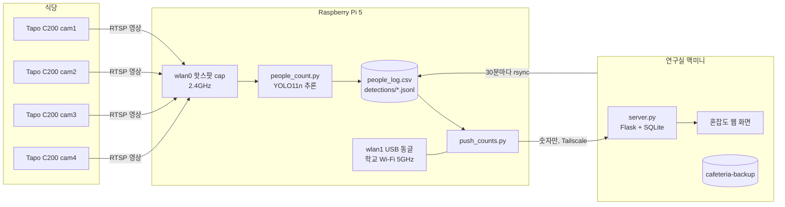

# 밥먹을래말래 · 카메라 기반 학내 식당 실시간 혼잡도 안내 시스템

> 캡스톤디자인 인수인계·발표 대비 문서
> 팀: (학번) 이승원, (학번) 팀원 · 지도교수 (순천향대학교 컴퓨터공학과)
> 최종 정리: 2026-10-27 (진행 기록·역할 분담 포함)

이 문서는 "무엇을, 왜, 어떻게 만들었는지"를 발표 때 설명할 수 있도록 정리한 것입니다. 비밀번호·토큰 같은 비밀 값은 **일부러 넣지 않았습니다** ([비밀 값 관리](#18-비밀-값-관리) 참고).

---

## 목차
1. [한 줄 요약과 현재 상태](#1-한-줄-요약과-현재-상태)
2. [문제와 목표](#2-문제와-목표)
3. [전체 구조](#3-전체-구조)
4. [사용 기술 한눈에 보기](#4-사용-기술-한눈에-보기)
5. [하드웨어](#5-하드웨어)
6. [네트워크 설계](#6-네트워크-설계)
7. [인원 계산 프로그램 people_count.py](#7-인원-계산-프로그램-people_countpy)
8. [데이터 전송과 서버](#8-데이터-전송과-서버)
9. [웹 화면](#9-웹-화면)
10. [혼잡도 판단 논리와 한계](#10-혼잡도-판단-논리와-한계)
11. [테이블 단위 판정 (진행 중)](#11-테이블-단위-판정-진행-중)
12. [기록 데이터와 설정 변경 이력](#12-기록-데이터와-설정-변경-이력)
13. [개인정보·윤리](#13-개인정보윤리)
14. [운영 매뉴얼](#14-운영-매뉴얼)
15. [진행 기록 (날짜별)](#15-진행-기록-날짜별)
16. [겪은 문제와 해결](#16-겪은-문제와-해결)
17. [포스터 수정 내역](#17-포스터-수정-내역)
18. [비밀 값 관리](#18-비밀-값-관리)
19. [역할 분담](#19-역할-분담)
20. [남은 일](#20-남은-일)
21. [발표 예상 질문과 답변](#21-발표-예상-질문과-답변)
22. [용어 정리](#22-용어-정리)

---

## 1. 한 줄 요약과 현재 상태

학생회관 1층 식당에 카메라 4대를 달고, 라즈베리파이 5가 현장에서 YOLO로 **사람 수만 세어 숫자로** 서버에 보내면, 서버가 **좌석 수 대비 인원으로 혼잡도(여유·보통·혼잡)를 판단하고 지난 평일 기록으로 시간대별 혼잡을 예측**해 웹으로 보여주는 시스템입니다. 영상은 저장하거나 전송하지 않습니다.

### 현재 상태 (2026-10-22 기준)
| 구분 | 상태 |
|---|---|
| 카메라 | 4대 설치·연결 완료 (cam4는 10/22 16:34 추가) |
| 추론 | YOLO11n 1280 (cam4는 720p·960), **NCNN 실행**, 4대 1회 약 2초, 피크 3초·평상시 5초 주기로 자동 운영 |
| 전송·서버 | 라즈베리파이 → 맥미니 5초마다 전송, SQLite 저장, 웹 화면 운영 중 |
| 백업 | 맥미니가 30분마다 라즈베리파이 기록 자동 백업 |
| 자동 복구 | 라즈베리파이·맥미니 모두 부팅 시 자동 시작, 장애 시 자동 재시작 |
| 온도 | 60℃대, 스로틀링 없음 |
| 미완료 | **집계 구역 (cam3·cam4 중복 계수 중)**, 실제 좌석 수, 테이블 영역 등록·판정, cam4 무선 연결 개선, 정확도 평가, 외부 공개 |

---

## 2. 문제와 목표

### 문제
- 점심시간에 학생이 한꺼번에 몰리지만, 식당에 가기 전에는 얼마나 붐비는지, 빈자리가 있는지 알 수 없다.
- 학생식당은 예약이나 좌석 배정이 없어 실시간 좌석 정보를 얻을 방법이 없다.
- 그 결과 줄을 서다가 시간을 버리거나, 자리가 없어 식사를 포기한다.

### 목표
- "지금 가면 앉을 수 있나?"에 답하는 실시간 혼잡도 안내
- "언제 가면 덜 붐비나?"에 답하는 시간대별 예측
- 개인정보를 남기지 않는 방식 (숫자만 기록)

### 대상 식당
- 학생회관 1층 식당, 배식대 4곳: 대한짜장(중식), 수오미엔(쌀국수), 하즈벤(돈까스), 공여사맛집(덮밥)
- 테이블 T1~T22, 1인석 S1~S5, 키오스크, 입구 2곳
- 운영 시간: 평일 08:00~19:30 (금요일 일부 식당 조기 마감)
- 데이터 수집 기간: 2026-10-20 ~ 2026-11-05, 식당 설치 2026-10-21

---

## 3. 전체 구조



흐름을 말로 풀면 다음과 같습니다.

1. **카메라 → 라즈베리파이:** 카메라 4대가 라즈베리파이가 직접 띄운 Wi-Fi(cap)에 붙어 RTSP로 영상을 보낸다.
2. **라즈베리파이:** people_count.py가 카메라별 최신 프레임을 모아 YOLO11n으로 사람을 찾고, 카메라별 인원을 보정해 CSV에 기록한다. 사람별 위치(좌표)는 JSONL로 따로 남긴다. 영상은 메모리에서만 쓰고 버린다.
3. **라즈베리파이 → 맥미니:** push_counts.py가 CSV에 새로 생긴 줄을 5초마다 Tailscale을 통해 맥미니 서버로 보낸다. 서버가 꺼져 있었으면 다시 연결될 때 빠진 부분부터 이어서 보낸다.
4. **맥미니:** server.py가 SQLite에 저장하고, 혼잡 단계와 예측을 계산해 웹으로 보여준다. 별도로 30분마다 라즈베리파이의 기록 파일을 통째로 백업한다.

### 설계 원칙
- **엣지 처리:** 영상은 현장(라즈베리파이)에서 처리하고 숫자만 내보낸다. 개인정보와 네트워크 사용량을 함께 줄인다.
- **역할 분리:** 라즈베리파이는 "세기", 맥미니는 "저장·판단·보여주기". 혼잡 기준을 바꿔도 라즈베리파이를 건드릴 필요가 없다.
- **끊겨도 안 잃기:** 전송이 끊겨도 CSV에 남아 있고, 전송 위치를 기억해 이어서 보낸다. 맥미니도 30분마다 백업한다.
- **자동 복구:** 모든 프로그램이 부팅 시 자동 시작되고, 죽으면 자동으로 다시 켜진다.

---

## 4. 사용 기술 한눈에 보기

| 분야 | 기술 | 어디에, 왜 |
|---|---|---|
| 카메라 | Tapo C200, RTSP | 저렴하고 RTSP를 지원해 표준 방식으로 영상 수신 가능 |
| 엣지 장치 | Raspberry Pi 5 (8GB) | 현장에서 카메라 4대를 동시에 처리할 수 있는 저전력 컴퓨터 |
| 사람 검출 | YOLO11n (Ultralytics) | 가장 작은 YOLO 모델로 라즈베리파이 CPU에서 돌릴 수 있음 |
| 모델 실행 | **NCNN** (실패 시 ONNX + OpenCV DNN으로 자동 전환) | ARM CPU에 최적화되어 OpenCV DNN보다 약 2배 빠름. PyTorch 불필요 |
| 영상 처리 | OpenCV (Python) | RTSP 수신, 전처리, NMS, 영역 판정, 화면 그리기 |
| 웹 (현장) | Flask, MJPEG 스트림 | 카메라 화면 확인, 집계 구역·테이블 영역 설정 |
| 데이터 전송 | Python urllib, HTTP POST + API 키 | 외부 라이브러리 없이 숫자만 전송 |
| 원격 접속 | Tailscale (WireGuard 기반 VPN) | 학교 Wi-Fi가 바뀌어도 고정 주소로 접속, 포트 개방 불필요 |
| 서버 | Flask + gunicorn | 가벼운 Python 웹 서버, 맥에서 안정적으로 실행 |
| 저장소 | SQLite (WAL 모드) | 별도 DB 서버 없이 파일 하나로 저장, 소규모에 적합 |
| 웹 화면 | HTML/CSS/JavaScript, Pretendard 폰트 | PC·모바일 반응형 혼잡도 화면 |
| 네트워크 | NetworkManager(nmcli), dnsmasq | 핫스팟, Wi-Fi 우선순위, 카메라 IP 고정 |
| 자동 실행 | systemd (라즈베리파이), launchd (맥) | 부팅 시 자동 시작, 장애 시 자동 재시작 |
| 백업 | rsync + SSH 키 | 30분마다 변경분만 맥미니로 복사 |
| 협업 | SSH 계정 분리, tmux 공유 세션, Tailscale Share | 팀원이 같은 터미널을 함께 보며 작업 |

---

## 5. 하드웨어

| 장비 | 내용 | 비고 |
|---|---|---|
| Raspberry Pi 5 8GB | 호스트명 `raspberrypi`, 사용자 `seung` | 케이스 장착, 부하 시 약 60~65℃, `throttled=0x0` |
| 부팅 장치 | 연구실 공용 USB 메모리 (SanDisk 32GB) | 기존 SD카드가 고장나 USB 부팅으로 전환 |
| 전원 | 3A USB-PD 어댑터 | `config.txt`에 `usb_max_current_enable=1`. 공식 27W(5A) 어댑터 권장 |
| USB 무선랜 동글 | Realtek RTL8822BU (`0bda:b812`), 드라이버 `rtw88_8822bu`, 듀얼밴드 | USB 2.0 포트(480M)에 연장선으로 연결 |
| 카메라 | Tapo C200 × 4 | 2.4GHz 전용, stream1=1920×1080, stream2=1280×720 |

### 구매 내역 (학교 지원금)
| 품목 | 금액 |
|---|---|
| Tapo C200 (1대당 38,340원) | 3대 115,020원 + 추가 1대 38,340원 |
| 케이블 몰딩 (60mm × 10m) | 19,900원 |
| 라즈베리파이 5 알루미늄 방열 케이스 | 32,900원 |
| 멀티탭 | 25,200원 |
| USB 3.0 연장 케이블 | 22,900원 |

학교 지원금으로는 저장장치(USB, SSD)를 살 수 없어 연구실 공용 USB를 사용 중입니다.

### 왜 USB 동글을 따로 썼나
라즈베리파이 내장 Wi-Fi 하나로는 "카메라용 핫스팟"과 "인터넷 연결"을 동시에 안정적으로 하기 어렵습니다. 그래서 **내장 wlan0은 카메라 핫스팟 전용**, **USB 동글 wlan1은 인터넷 전용**으로 나눴습니다.

### 왜 동글을 USB 2.0 포트에 꽂았나
RTL8822BU가 USB 3.0 모드로 동작하면 2.4GHz 대역에 전파 간섭을 일으킵니다. 카메라 핫스팟이 2.4GHz라서, 동글을 USB 2.0 포트에 꽂고 드라이버 옵션 `switch_usb_mode=n`으로 USB 3.0 전환을 막았습니다. 인터넷 속도는 USB 2.0 한계(수백 Mbps)로 줄지만 숫자만 보내므로 충분합니다. 부팅 USB는 속도를 위해 USB 3.0 포트(5000M)에 꽂습니다.

---

## 6. 네트워크 설계

### 6-1. 인터페이스 역할
| 인터페이스 | 역할 | 대역 |
|---|---|---|
| wlan1 (USB 동글) | 인터넷 (학교 Wi-Fi) | 5GHz 우선 |
| wlan0 (내장) | 카메라 전용 핫스팟 `cap` | 2.4GHz, 채널 11 |
| tailscale0 | 원격 접속, 맥미니로 데이터 전송 | VPN |

### 6-2. Wi-Fi 프로필 (NetworkManager)
모든 인터넷 프로필은 이름(wlan1) 대신 **동글의 MAC 주소**(`<MAC>`)에 묶었습니다. 동글 이름이 바뀌어도 프로필이 따라가고, 내장 wlan0이 실수로 학교 Wi-Fi를 잡는 일을 막습니다.

| 프로필 | 용도 | 우선순위 |
|---|---|---|
| school5g | 식당의 학교 Wi-Fi 5GHz (실제 연결, 신호 약 -56dBm) | 20 |
| school | 같은 Wi-Fi의 2.4GHz | 15 |
| iphone | 아이폰 핫스팟 (비상용, 현장 복구용) | 10 |
| ECLAB_5G | 연구실 Wi-Fi | 8 |

모두 `autoconnect yes`, `autoconnect-retries 0`(무한 재시도)입니다.

### 6-3. 카메라 핫스팟과 IP 고정
- 프로필 `cam-ap`: SSID `cap`, AP 모드, 2.4GHz 채널 11, `ipv4.method shared` (라즈베리파이가 <내부 주소>, DHCP 서버 역할)
- 카메라 IP는 `/etc/NetworkManager/dnsmasq-shared.d/cams.conf`에서 MAC 기준으로 고정

| 카메라 | IP | MAC | RTSP 아이디 |
|---|---|---|---|
| cam1 | <cam1-IP> | <MAC> | camera |
| cam2 | <cam2-IP> | <MAC> | camera2 |
| cam3 | <cam3-IP> | <MAC> | camera3 |
| cam4 | <cam4-IP> | <MAC> | camera4 |

**왜 카메라를 학교 Wi-Fi가 아니라 자체 핫스팟에 붙였나**
- 학교 Wi-Fi는 기기 간 통신이 막혀 있거나 인증이 필요해 카메라를 직접 붙이기 어렵다.
- 카메라 영상이 학교 네트워크로 나가지 않으므로 개인정보 측면에서도 안전하다.
- Tapo C200은 2.4GHz만 지원해서, 2.4GHz 전용 핫스팟을 따로 두는 게 맞다.

### 6-4. 안정화 설정
- **Wi-Fi 절전 끄기:** `/etc/NetworkManager/conf.d/wifi-powersave-off.conf`(`wifi.powersave = 2`) + 프로필마다 `802-11-wireless.powersave 2`. 절전 모드는 연결 끊김의 흔한 원인이다.
- **동글 드라이버 옵션:** `/etc/modprobe.d/rtw88.conf`
  - `options rtw88_core disable_lps_deep=y` → 깊은 절전 끄기
  - `options rtw88_usb switch_usb_mode=n` → USB 3.0 전환 막기 (2.4GHz 간섭 방지)
- Wi-Fi 국가 코드 KR

### 6-5. Tailscale
| 기기 | Tailscale IP |
|---|---|
| raspberrypi | <라즈베리파이 Tailscale IP> |
| macmini | <맥미니 Tailscale IP> |
| 노트북 (node) | <노트북 Tailscale IP> |

- 학교 Wi-Fi가 바뀌어도 IP가 고정되고, 공유기 포트를 열 필요가 없다.
- 팀원(재영)은 Tailscale **Share**로 라즈베리파이만 공유받는다. 맥미니는 공유하지 않으면 보이지 않는다.

---

## 7. 인원 계산 프로그램 people_count.py

위치: 라즈베리파이 `/home/seung/people_count.py`, systemd 서비스 `people-count` (User=seung, Restart=always)

### 7-1. 처리 흐름
1. **카메라별 수신 스레드:** 카메라마다 백그라운드 스레드가 RTSP(TCP)로 영상을 계속 읽고 **가장 최신 프레임 1장만** 들고 있는다. 오래된 프레임이 쌓이지 않아 지연이 없다.
2. **멈춤 감지:** 마지막 프레임이 5초(`STALE_SEC`)보다 오래되면 그 카메라는 끊긴 것으로 보고 0명으로 기록하지 않는다. 0명과 "모름"을 구분하기 위해서다.
3. **추론:** 주기마다 4대의 최신 프레임을 모아 YOLO11n(입력 1280×1280)으로 사람(class 0)을 찾는다.
4. **후처리:** 신뢰도 0.2 미만 버림 → NMS(겹침 기준 0.6)로 같은 사람의 중복 박스 제거.
5. **집계 구역 판정:** 박스 아래 가운데(**발 위치**)가 그 카메라의 구역 안에 있는 사람만 센다.
6. **보정:** 최근 15초 동안의 값 중 75퍼센타일을 그 카메라의 인원으로 쓴다.
7. **기록:** CSV(카메라별 인원, 합계)와 JSONL(사람별 좌표)에 기록한다.

### 7-2. 주요 설정 (2026-10-27 18:46 기준)
| 설정 | 값 | 의미 |
|---|---|---|
| `STREAM` / `STREAMS` | stream1 / `{"cam4": "stream2"}` | 기본 1080p. cam4만 720p (무선 연결이 약해 10/26 변경) |
| `MODEL` / `IMG` | yolo11n_1280.onnx / 1280 | 입력 1280 모델 (720p 카메라는 `SD_MODEL` yolo11n_960.onnx / 960) |
| `CONF` | 0.2 | 이 점수 미만 박스는 버림 |
| `NMS` | 0.6 | 겹친 박스 제거 기준 |
| `SMOOTH_SEC` / `SMOOTH_PCT` | 15 / 75 | 최근 15초 값의 75퍼센타일 |
| `STALE_SEC` | 5 | 5초 넘게 새 프레임 없으면 끊김 |
| `OPEN_HOURS` / `OPEN_DAYS` | 08:00~19:30 / 월~금 | 운영 외 시간은 영상 수신까지 정지 |
| `PEAK_HOURS` | 11:00~14:00, 17:00~19:00 | 피크 시간 |
| `USE_NCNN` / `NCNN_MODEL` / `SD_NCNN_MODEL` | True / yolo11n_1280_ncnn_model / yolo11n_960_ncnn_model | NCNN으로 실행, 실패 시 ONNX로 자동 전환 |
| `PEAK_INTERVAL` / `NORMAL_INTERVAL` | 3초 / 5초 | 추론 주기 (10/27 NCNN 적용 후 단축) |
| `OUT_FPS` | 2 | 관리 웹으로 보내는 화면 갱신 속도 |

### 7-3. 기술 선택 이유
- **YOLO11n:** YOLO 계열 중 가장 작아 라즈베리파이 CPU에서 실시간에 가깝게 돌릴 수 있다.
- **NCNN (10/27부터):** 처음에는 ONNX + OpenCV DNN으로 실행했다. 처리 시간을 줄이려고 같은 YOLO11n을 NCNN 형식으로 변환해 비교한 결과, **검출 인원과 점수는 똑같고 속도는 약 2배**였다. NCNN은 휴대폰·라즈베리파이 같은 ARM CPU에 맞춰 만든 추론 엔진이다. NCNN을 불러오지 못하거나 실행 중 오류가 나면 자동으로 ONNX + OpenCV DNN으로 전환해 수집이 멈추지 않게 했다.
- **ONNX + OpenCV DNN (대체 경로):** PyTorch 없이 OpenCV만으로 추론할 수 있어 설치가 가볍다. 지금은 NCNN이 실패할 때의 대체 동작으로 남겨 두었다.
- **입력 1280:** 천장에서 넓게 찍으면 사람이 작게 나온다. 960 모델에서 cam1은 거의 못 잡았는데(0~2명), 1280으로 바꾼 뒤 4~8명으로 크게 좋아졌다. 대신 처리 시간이 늘었다.
- **발 위치 기준:** 같은 사람이 두 카메라에 함께 보일 때, 바닥 위치로 "어느 카메라 구역에 서 있는지"를 정하면 한 카메라에서만 세게 할 수 있다. 박스 중심보다 바닥 위치가 원근 왜곡에 덜 흔들린다.
- **75퍼센타일 보정:** YOLO는 가끔 한 장면에서 사람을 놓친다(갑자기 숫자가 떨어짐). 중앙값(50)보다 높은 75를 쓰면 깜빡이는 사람을 조금 더 너그럽게 센다.
- **피크/평상시 주기:** 붐빌 때는 자주(3초), 한산할 때는 덜 자주(5초), 운영 외 시간은 아예 멈춰서 발열과 전력을 줄인다.

### 7-4. 처리 시간 (실측)
| 구성 | 1회 추론 시간 |
|---|---|
| 강의실 테스트, 640 모델, 3대 | 약 0.6초 |
| 식당, 1280 모델, 3대 | 약 3.8초 |
| 식당, 1280 모델, 4대, OpenCV DNN | 약 5.6~5.9초 |
| 식당, 1280 모델(cam4는 960), 4대, OpenCV DNN | 약 4.4~4.7초 |
| 식당, 1280 모델(cam4는 960), 4대, **NCNN** | **약 1.7~2.3초** |

4대에서 5초를 넘어 피크 주기를 6초로 늘렸다가, NCNN으로 바꾼 뒤 피크 3초·평상시 5초로 줄였습니다.

### 7-4-1. NCNN 비교 실험 (bench_ncnn.py)
- 방법: 운영 중인 시스템은 그대로 두고, cam2의 실시간 장면 3장을 **메모리에서만** 받아 같은 입력(1280)으로 장면마다 5번씩 처리 (사진 저장 안 함)
- 결과 (운영 중 CPU를 함께 쓰는 상태에서 측정):

| 실행 방식 | 장당 처리 시간 | 장면별 인원 | 평균 점수 |
|---|---|---|---|
| OpenCV DNN (ONNX) | 2,165ms | 14, 13, 14 | 0.53 |
| NCNN | 1,408ms | 14, 13, 14 | 0.53 |

- 같은 조건에서 1.5배 빠르고 결과는 동일 → 교체. 실제 운영에서는 people_count.py와 CPU를 나눠 쓰지 않아 **약 2배**(4대 1회 약 4.5초 → 약 2초)로 나타남
- 모델 변환: 맥미니에서 Ultralytics로 `yolo export model=yolo11n.pt format=ncnn imgsz=1280` (cam4용은 `imgsz=960`). 원본은 맥미니 `~/ncnn-export`에 보관

### 7-5. 현장 관리 웹 (포트 5000)
| 주소 | 기능 |
|---|---|
| `/` | 카메라 4대 화면, 검출 박스, 카메라별 인원, 집계 구역 설정 |
| `/video/<cam>` | MJPEG 영상 스트림 |
| `/count`, `/status` | 카메라별 인원, 현재 모드(JSON) |
| `/zone/<cam>` (POST) | 집계 구역 저장 → `zones.json`, 이력 `zones_history.jsonl` |
| `/tables` | 테이블 영역 설정 화면 (11장) |
| `/api/tables`, `/api/tables/<cam>` | 테이블 영역 조회·저장 → `tables.json`, 이력 `tables_history.jsonl` |
| `/api/last` | 마지막 추론의 사람 위치 (테이블 미리보기용) |
| `/api/setup` (POST) | 운영 외 시간에 테이블 설정 화면을 열면 영상만 잠시 받기 |

집계 구역은 꼭짓점 좌표를 화면 크기 대비 비율(0~1)로 저장해서, 해상도를 바꿔도 그대로 유지됩니다.

---

## 8. 데이터 전송과 서버

### 8-1. push_counts.py (라즈베리파이)
위치: `/home/seung/push_counts.py`, systemd 서비스 `push-counts`

- 5초마다 `people_log.csv`에서 **지난번에 보낸 위치 이후의 새 줄**만 읽어 맥미니 `/api/ingest`로 보낸다.
- 보낸 위치(바이트)는 `~/.push_offset`에 저장한다. 서버가 꺼져 있으면 위치를 그대로 두고, 다시 연결되면 빠진 줄부터 한꺼번에(최대 500줄씩) 보낸다.
- 쓰는 중인 마지막 줄(줄바꿈 없음)은 건너뛰어 반쪽짜리 기록을 보내지 않는다.
- 요청 헤더 `X-API-Key`에 토큰을 넣어 라즈베리파이만 데이터를 넣을 수 있게 했다.
- 외부 라이브러리 없이 Python 표준 `urllib`만 사용.

### 8-2. server.py (맥미니)
위치: `~/cafeteria-server/`, gunicorn(워커 1, 스레드 4)으로 포트 8000, launchd `kr.sch.cafeteria`

| API | 기능 |
|---|---|
| `POST /api/ingest` | 토큰 확인 후 기록 저장. `INSERT OR IGNORE`로 같은 시각 중복은 자동 무시 |
| `GET /api/latest` | 최신 인원, 카메라별 인원, 혼잡 단계, 운영 여부, 수신 지연 여부 |
| `GET /api/today` | 오늘 기록 (최대 600점으로 줄여서) |
| `GET /api/slots` | 식사 시간대 15분 칸별 오늘 실제값 + 지난 평일 평균(예측) |
| `GET /` | 혼잡도 웹 화면 (index.html) |

**SQLite 테이블**
```sql
CREATE TABLE counts(
  ts TEXT PRIMARY KEY,   -- 측정 시각 'YYYY-MM-DD HH:MM:SS'
  total INTEGER,         -- 보정된 합계
  total_raw INTEGER,     -- 보정 전 합계
  cams TEXT,             -- 카메라별 인원 JSON
  mode TEXT,             -- peak / normal
  received_at TEXT       -- 서버가 받은 시각 (수신 지연 판단)
);
```
WAL 모드를 켜서 저장과 조회가 동시에 일어나도 막히지 않게 했습니다.

**주요 설정**
- `CAPACITY = 120` : **임시값.** 실제 좌석 수로 바꿔야 함
- `STALE_SEC = 60` : 60초 넘게 데이터가 안 오면 "수신 지연"
- 혼잡 단계: 빈자리 비율 30% 이상 여유, 10~30% 보통, 10% 미만 혼잡 (좌석 대비 인원 70% 미만 / 70~90% / 90% 이상과 같음)

### 8-3. 예측 방식 (`/api/slots`)
- 시간대: 점심 11:00~14:00, 저녁 16:30~19:30. 15:15를 기준으로 그래프가 바뀜
- 15분 칸마다 **날짜별 평균을 먼저 구한 뒤, 지난 평일들의 평균**을 예측값으로 쓴다. 기록이 많은 날이 결과를 좌우하지 않게 하려는 것
- 요일별로 나누면 수집 기간(평일 약 13일) 동안 요일당 2~3일뿐이라, 평일 전체 평균을 쓴다
- 오늘 지난 칸은 실제 평균, 지금 칸은 지금까지의 평균, 앞으로의 칸은 예측값

### 8-4. 맥미니 운영 설정
- **자동 실행:** `~/Library/LaunchAgents/kr.sch.cafeteria.plist` (RunAtLoad, KeepAlive)
- **잠자기 끄기·정전 후 자동 켜기:** `sudo pmset -a sleep 0 disksleep 0 autorestart 1`
- **로그:** `~/cafeteria-server/logs/out.log`, `err.log`

### 8-5. 백업
- `~/cafeteria-server/backup_pi.sh`를 launchd `kr.sch.cafeteria.backup`이 **30분마다** 실행
- rsync로 라즈베리파이의 `detections/`, `people_log.csv`, `zones.json`, `zones_history.jsonl`, `tables.json`, `tables_history.jsonl`, `people_count.py`를 `~/cafeteria-backup/`으로 복사
- 변경된 부분만 복사하고, 라즈베리파이에서 지워진 파일도 맥미니에는 남는다 (`--delete` 미사용)
- 비밀번호 없이 접속하도록 맥미니의 SSH 키를 라즈베리파이에 등록 (`ssh-copy-id`)

---

## 9. 웹 화면

### 혼잡도 안내 화면 (맥미니 `:8000`)
목업 디자인을 바탕으로 만든 반응형 화면 (PC 2단, 모바일 1단)

| 구성 | 내용 | 데이터 |
|---|---|---|
| 헤더 | 로고, 식당 이름, 실시간 표시, 새로고침 | `/api/latest` |
| 지금 가면 | 혼잡 단계에 따른 큰 문장, 현재 인원, 빈자리 추정, 3칸 게이지 | `/api/latest` |
| 추세 | 최근 10분과 그 전 10분 평균 비교 (좌석의 5% 이상 차이면 붐비는 중/한산해지는 중) | `/api/today` |
| 조금 미룰 수 있다면 | 남은 시간 중 예측 인원이 가장 적은 칸 추천 (지금보다 좌석의 10% 이상 적을 때) | `/api/slots` |
| 오늘 점심/저녁 예측 | 15분 막대그래프. 지난 시간 흐리게, 지금 칸 강조 | `/api/slots` |
| 좌석 현황 | 카메라 구역별 인원 막대, 테이블 칸(판정 기능 적용 전 자리표시) | `/api/latest` |
| 하단 | 영상 미저장 안내, 시범 운영 안내 | — |

- 10초마다 최신값, 60초마다 그래프와 예측을 다시 불러온다
- 운영 외 시간, 데이터 지연, 데이터 없음 상태를 따로 보여준다
- 외부 그래프 라이브러리 없이 막대를 HTML 요소로 직접 그린다

### 현장 관리 화면 (라즈베리파이 `:5000`)
카메라 영상과 검출 박스 확인, 집계 구역 설정, 테이블 영역 설정 (7-5 참고)

---

## 10. 혼잡도 판단 논리와 한계

### 지금 방식: 좌석 대비 인원
- **측정하는 것:** 카메라로 식당 안 **사람 수**를 센다.
- **판단 기준:** 전체 좌석 수와 비교해 빈자리를 **추정**한다. `빈자리 ≈ 좌석 수 − 인원`
- 사람 수는 YOLO가 비교적 안정적으로 셀 수 있는 값이라 데이터가 깨끗하게 쌓이고, "언제 붐비나"라는 시간 패턴을 잡기에 충분하다.

### 한계
| 한계 | 원인 | 영향 |
|---|---|---|
| 좌석 수만큼 앉을 수 없음 | 4인 테이블에 2명이 앉으면 남은 자리에 모르는 사람이 잘 안 앉음 | 인원이 좌석의 70%만 돼도 실제로는 꽉 찬 느낌일 수 있음 (가장 큰 차이) |
| 앉지 않은 사람도 셈 | 키오스크 줄, 배식대 앞, 지나가는 사람 | 피크 때 인원이 많게 나옴 |
| 앉은 사람을 놓침 | 위에서 본 각도, 가려짐, 화면 가장자리 | 인원이 적게 나옴 |
| 가방으로 맡아 둔 자리 | 사람이 없으니 빈자리로 계산 | 빈자리를 많게 봄 |

### 보완 계획
1. **혼잡 기준 실측 보정 (교수님 피드백):** 파일럿 기간에 "빈 테이블을 쉽게 찾음 / 어려움 / 못 찾음"을 기록하고 그때 시스템 인원과 맞춰 실제 기준을 정한다.
2. **집계 구역으로 줄 선 사람 빼기:** 키오스크·배식대 앞을 구역에서 제외한다.
3. **정확도 평가:** 실제 인원과 시스템 인원을 수기로 비교한 표를 만들어 평균 오차를 낸다.
4. **예측 검증:** 첫째 주 데이터로 둘째 주를 예측해 평균 오차를 계산한다.
5. **테이블 단위 판정:** 11장.

---

## 11. 테이블 단위 판정 (진행 중)

### 왜 가능한가
`detections_*.jsonl`에 **사람마다 발 위치와 박스 좌표가 이미 기록**되어 있습니다. 테이블 영역을 나중에 정해도, 10/20부터 쌓인 기록에 거꾸로 적용해 과거 데이터에서도 테이블별 점유를 계산할 수 있습니다. 운영 중인 시스템을 건드리지 않고 먼저 실험할 수 있습니다.

### 진행 순서
1. **커버리지 지도:** 테이블 27개마다 가장 잘 보이는 카메라 하나를 담당으로 정한다 (겹치면 중복 계수). cam4는 사각지대를 덮기 위해 추가.
2. **테이블 영역 등록 (도구 완성):** `/tables` 화면에서 테이블마다 꼭짓점 3~8개, 번호, 좌석 수, "일부만 보임" 여부를 저장. 의자까지 포함해 넓게 찍는다.
3. **기록으로 실험:** 쌓인 JSONL에 영역을 적용해 판정 규칙을 정한다.
   - 시간 창 판정: 최근 30~60초 중 일정 비율 이상 검출되면 사용 중 (한 장면 놓침 보완)
   - 자리 비움 타임아웃: 사람이 사라져도 몇 분 기다린 뒤 빈자리로
   - 발 위치와 박스 중심 중 어느 기준이 잘 맞는지 비교
4. **실시간 적용:** people_count.py → push_counts → 서버 → 웹의 테이블 칸 채우기. 학생에게는 "완전히 빈 테이블 수"를 크게 보여준다.
5. **정확도:** 현장에서 사용 중인 테이블 번호를 수기로 적어 판정과 비교.

### tables.json 형식
```json
{
  "cam1": [
    {"id": "T3", "seats": 4, "partial": false, "pts": [[0.42, 0.10], [0.62, 0.10], [0.62, 0.42], [0.42, 0.42]]}
  ]
}
```

---

## 12. 기록 데이터와 설정 변경 이력

### 파일
| 파일 (라즈베리파이 `/home/seung`) | 내용 |
|---|---|
| `people_log.csv` | `timestamp, cam1, cam2, cam3, cam4, total, total_raw, mode, interval`. 끊긴 카메라는 빈칸 |
| `people_log.csv.bak_3cam` | cam4 칸 추가 전 원본 |
| `detections/detections_YYYY-MM-DD.jsonl` | 추론마다 한 줄 |
| `zones.json`, `zones_history.jsonl` | 집계 구역과 변경 이력 |
| `tables.json`, `tables_history.jsonl` | 테이블 영역과 변경 이력 |

### detections JSONL 한 줄
```json
{"t": "2026-10-22 16:35:21", "mode": "normal", "interval": 8.0,
 "cams": {"cam1": {"w": 1920, "h": 1080,
                   "p": [[발x, 발y, 박스x, 박스y, 박스w, 박스h, 점수, 구역안여부], ...]},
          "cam2": null}}
```
`null`은 그 회차에 카메라가 끊겼다는 뜻입니다. 이미지는 저장하지 않습니다.

### 데이터 양
- 하루 약 9,000~11,000회 추론 (10/27부터 피크 3초·평상시 5초 기준. 이전 피크 6초·평상시 8초는 약 5,900회)
- 11/5까지 1GB 미만 예상

### 설정 변경 이력 (분석할 때 구간을 나눠야 함)
| 시각 | 변경 |
|---|---|
| 2026-10-21 15:34 | 식당 첫 기록 |
| 2026-10-21 16:30 전후 | 모델·화질 설정 확정 (1280 모델, 1080p). **이전 데이터는 조건이 달라 구분 필요** |
| 2026-10-22 16:34 | **cam4 추가 (4대)** |
| 2026-10-22 16:36 | 피크 주기 5초 → 6초, 보정 시간 창 8초 → 15초 |
| 2026-10-26 오전~10:10 | cam4 IP 변경으로 연결 끊김 (cam4 빈칸) → 핫스팟 재시작으로 고정 IP 적용 |
| 2026-10-26 14:37경 | **cam4만 720p(stream2)·960 모델로 변경** (무선 연결 약함). 이후 cam4는 다른 카메라와 조건이 다름 |
| 2026-10-26 오후 | cam4 연결이 약해 핫스팟 전체가 느려져 cam4를 잠시 차단(iptables) → 다시 해제. 차단 동안 cam4 빈칸 |
| **2026-10-27 18:44** | **추론 엔진을 OpenCV DNN → NCNN으로 교체** (4대 1회 약 4.5초 → 약 2초, 결과 동일) |
| **2026-10-27 18:46** | **피크 6초 → 3초, 평상시 8초 → 5초** (하루 기록 수 약 2배) |
| (예정) | 집계 구역 설정, 실제 좌석 수 반영 |

---

## 13. 개인정보·윤리

- **영상은 저장·전송하지 않는다.** 라즈베리파이 메모리에서 처리하고 버린다. 기록하는 것은 사람 수와 박스 좌표(숫자)뿐이다.
- 카메라는 학교 네트워크가 아닌 라즈베리파이 전용 핫스팟에만 연결된다.
- 관리 화면의 실시간 영상은 Tailscale에 들어온 팀원만 볼 수 있다.
- **식당 안내문:** A4 "카메라 운영 안내" — 캡스톤디자인 목적, 개인정보 수집 안 함, 영상 저장·전송 안 함, 숫자만 기록, 학생회관 1층 카메라, 평일 08:00~19:30, 기간 2026.10.20~11.05, 문의 어굿플레이스((이메일))
- **포스터 사진:** 사람은 모두 모자이크, 화면의 촬영 날짜·시각과 로그의 시각·IP는 불투명하게 가림
- **추가 학습용 사진 수집은 하지 않음:** 안내문에 "영상 저장 안 함"으로 공지했으므로, 필요하면 동의받은 촬영이나 안내문 수정·교수님 상의가 먼저
- **외부 공개(Tailscale Funnel)는 보류:** 숫자 정확도(구역, 좌석 수) 확보, 교수님 승인, 안내문에 "웹으로 안내" 추가 후 진행

---

## 14. 운영 매뉴얼

### 주소 (Tailscale 연결 필요)
| 용도 | 주소 |
|---|---|
| 혼잡도 화면 | http://<맥미니 Tailscale IP>:8000 |
| 카메라 관리 | http://<라즈베리파이 Tailscale IP>:5000 |
| 테이블 영역 설정 | http://<라즈베리파이 Tailscale IP>:5000/tables |
| 라즈베리파이 SSH | `ssh seung@<라즈베리파이 Tailscale IP>` (같은 Wi-Fi면 `seung@raspberrypi.local`) |
| 팀원 SSH | `ssh jeyoung@<라즈베리파이 Tailscale IP>` |

### 라즈베리파이
```bash
# 상태
systemctl status people-count push-counts --no-pager
sudo journalctl -u people-count -n 10 --no-pager     # 카메라 연결, 인원, 처리 시간
sudo journalctl -u push-counts -n 5 --no-pager       # sent 1 {'inserted': 1, 'ok': True}

# 재시작
sudo systemctl restart people-count

# 네트워크
nmcli device status
iw dev wlan1 link                                    # 학교 Wi-Fi 신호
sudo cat /var/lib/NetworkManager/dnsmasq-wlan0.leases   # 카메라 IP

# 온도 (70℃ 미만, throttled=0x0 정상)
vcgencmd measure_temp; vcgencmd get_throttled

# 안전하게 끄기 (빨간 LED만 남으면 전원 분리)
sudo shutdown -h now
```

### 맥미니
```bash
curl -s http://localhost:8000/api/latest; echo                 # 서버 확인
launchctl kickstart -k gui/$(id -u)/kr.sch.cafeteria           # 서버 재시작
tail -7 ~/cafeteria-server/logs/backup.log                     # 백업 확인
```

### 팀원 tmux 공유
```bash
# seung이 세션을 열고 허용 (재부팅 후마다)
tmux -S /tmp/team new -s team -d
sudo chmod 777 /tmp/team
tmux -S /tmp/team server-access -a jeyoung
# 재영 접속
tmux -S /tmp/team attach -t team      # 나가기: Ctrl+b 후 d
```

### 카메라 추가 절차 (cam4 때 한 방법)
1. Tapo 앱으로 `cap`에 연결, 카메라 계정(RTSP) 생성
2. `dnsmasq-wlan0.leases`에서 새 MAC·IP 확인 → `cams.conf`에 `dhcp-host=MAC,IP` 추가 → **바로 `sudo nmcli connection up cam-ap`으로 적용** (카메라 전체가 1분 끊기니 피크 외 시간에). 적용하지 않으면 카메라가 재접속할 때 다른 IP를 받아 연결이 끊김
3. `people-count` → `push-counts` 순서로 정지
4. people_count.py `CAMS`에 한 줄 추가
5. **people_log.csv 헤더에 새 카메라 칸 추가**, `.push_offset`을 파일 끝으로 (안 하면 칸이 밀려 total이 잘못 전송됨)
6. 다시 시작, 로그에서 `connected`와 처리 시간 확인

---

## 15. 진행 기록 (날짜별)

### 10/14 이전 · 준비와 강의실 테스트
- 작품 기획, 학술제 포스터 제출
- 강의실에서 카메라 3대로 첫 테스트: YOLO11n 640 모델, 1회 추론 약 0.6초, 집계 구역 기능 확인
- 기존 SD카드 고장 → 연구실 공용 USB 메모리로 USB 부팅하기로 결정

### 10/20 (화) · 라즈베리파이 재세팅과 네트워크 구성
- USB 부팅으로 OS 재설치, 사용자 seung, Tailscale 연결
- USB 무선랜 동글(RTL8822BU) 인식, Wi-Fi 프로필 4개를 동글 MAC에 묶어 인터넷을 wlan1로 분리
- 점검 결과 아이폰 핫스팟 우선 연결, 절전 켜짐, 드라이버 옵션 미적용, cap 핫스팟 없음 → 우선순위 조정, 절전 끄기, 드라이버 옵션, cap 생성
- 부팅 USB는 USB 3.0 포트, 동글은 USB 2.0 포트로 재배치

### 10/21 (수) · 식당 설치, 서버·웹 구축
- **식당 설치:** 카메라 3대, 학교 Wi-Fi(school5g) 연결, 카메라 IP 고정
- **15:34** 첫 기록, **16:30 전후** 1280 모델·1080p 확정 (cam1 0~2명 → 4~8명)
- **팀원 접속:** Tailscale Share, jeyoung 계정, tmux 공유 세션
- **18:04** 맥미니 Flask + SQLite 서버, **18:08** push_counts 서비스
- **18:10** 맥미니 launchd 자동 실행, 잠자기 끄기, 정전 후 자동 켜기
- **18:14** 30분 자동 백업
- **18:30** 목업 디자인으로 웹 개편, 15분 단위 예측(`/api/slots`) 추가
- **밤:** 포스터 검출 사진 교체(모자이크), 포스터 내용 수정, 테이블 영역 설정 페이지(`/tables`) 추가
- 외부 공개(Tailscale Funnel)는 정확도 확보·교수님 승인 전까지 보류하기로 결정

### 10/22 (목) · cam4 추가
- cam4 설치, 핫스팟 연결 (MAC <MAC> → <cam4-IP> 고정)
- **16:34** people_count.py에 cam4 추가, 기록 파일 헤더에 cam4 칸 추가
- 4대 처리 시간 실측 약 5.6~5.9초 → **16:36** 피크 주기 6초, 보정 시간 창 15초
- 인수인계 문서(HANDOFF.md) 작성

### 10/26 (월) · cam4 주소 변경 장애
- 오전에 cam4가 `connect failed` 반복. Wi-Fi로는 붙어 있으나 <cam4-IP>에 응답 없음
- 원인: 10/22에 cams.conf에 고정 설정만 넣고 핫스팟을 다시 켜지 않아, 주말 사이 재접속하며 다른 IP을 받음
- 10:10경 `nmcli connection up cam-ap`으로 고정 설정 적용 → cam4가 .165로 복구, 4대 모두 고정 주소 확인
- 핫스팟 재시작 동안 카메라 4대가 1~2분 끊김 (그동안 기록은 빈칸)

### 10/26 (월) 오후 · cam4 무선 연결 불안정
- 14:33경부터 cam4가 `frame lost, reconnecting`을 반복하며 30초씩 끊기고 화면이 줄무늬로 깨짐
- 진단: 전송 실패(tx failed)가 cam4만 25,317회로 다른 카메라의 2.5~5배, ping 손실 40%·평균 2.7초
- 14:37경 cam4만 720p(stream2)로 변경 → 손실 0%, 평균 84ms로 개선 (cam2·cam3는 2~4ms, cam1 23ms)
- 결론: 채널 혼잡이 아니라 cam4(그다음 cam1)와 라즈베리파이 사이 거리·장애물 문제. 라즈베리파이를 cam4·cam1 쪽, 높은 곳으로 옮기는 것이 근본 해결

---

### 10/27 (화) · 신호 진단과 NCNN 교체
- 오전: cam4·cam1이 다시 끊김. 카메라별 무선 연결 속도를 비교해 **cam4의 영상 방향 속도가 1.0 Mbit/s**(cam2 26, cam3 39, cam1 13)로 가장 낮은 단계임을 확인 → 원인은 cam4와 라즈베리파이 사이 거리·장애물. 라즈베리파이 위치 조정 필요
- 로그에서 **cam3와 cam4 인원이 거의 같이 움직이는 것**(10/10, 9/9, 8/8)을 발견 → 집계 구역이 없어 두 카메라가 같은 사람을 중복으로 세는 중. 집계 구역 설정이 가장 시급
- 카메라가 한 회차만 빠져도 합계가 크게 출렁이는 문제 확인 (예: 28명 → 18명 → 26명) → 짧은 끊김 보정 필요
- 저녁: 처리 시간을 줄이려고 NCNN 비교 실험 → 결과 동일·1.5배 빠름 → **18:44 NCNN 교체, 18:46 피크 3초·평상시 5초**
- 실제 4대 1회 처리 약 1.7~2.3초 (교체 전 약 4.5초)

---

## 16. 겪은 문제와 해결

| 문제 | 원인 | 해결 |
|---|---|---|
| SD카드 고장 (노트북에서 31MB RAW) | SD카드 손상 | 연구실 공용 USB로 USB 부팅 |
| 첫 설정 화면 한글이 네모로 깨짐 | 한글 폰트 없음 | 영어로 설정 후 `fonts-nanum`, `fonts-noto-cjk` 설치 |
| 동글이 USB 3.0으로 재연결되며 `-71` 오류 | rtw88의 USB 모드 전환 | 정상 동작. 2.4GHz 간섭 때문에 `switch_usb_mode=n`, USB 2.0 포트 사용 |
| Wi-Fi 절전이 켜져 있음 | 기본값 | NetworkManager 설정 + 프로필별 + 드라이버 옵션으로 모두 끔 |
| 3대 → 4대 처리 시간이 피크 주기 초과 | 1280 모델 × 4대 ≈ 5.8초 | 피크 주기 6초로 조정 |
| 960 모델에서 cam1 거의 못 잡음 | 위에서 넓게 찍어 사람이 작음 | 1280 모델로 변경 (0~2명 → 4~8명) |
| 놓친 사람 중 일부는 점수 0.1 미만 | 모델 한계 | 기준을 더 낮춰도 해결 안 됨. 시간 창 판정·추가 학습·머리 검출 모델이 대안 |
| 가끔 h264 디코딩 오류 | 무선 영상 손실 | 멈춤 감지(5초) + 보정 시간 창으로 대부분 걸러짐 |
| 터미널에 긴 코드 붙여넣기가 잘리거나 섞임 | heredoc 잘림, tmux 안에서 붙여넣기 표시 문자(`^[[200~`) 유입 | 짧게 나눠 붙여넣기, tmux 밖에서 작업, 붙여넣은 뒤 `tail`·`grep`으로 확인 |
| 팀원 SSH `Permission denied` | 맥 사용자 이름(seung1_won)으로 접속 시도 | `jeyoung` 계정 생성 후 `ssh jeyoung@...` |
| 팀원이 tmux 공유 세션에 못 들어옴 | tmux 3.3+는 다른 사용자 접속을 기본 차단 | `server-access -a jeyoung` |
| 팀원 계정에서 `/home/seung` 접근 불가 | 홈 폴더 권한 | `sudo` 또는 seung 계정으로 작업 |
| cam4 추가 시 CSV 칸 밀림 위험 | 헤더가 3대 기준 | 기존 줄에 빈 cam4 칸을 넣어 헤더 맞춤 |
| cam4가 30초씩 반복해서 끊기고 화면이 줄무늬로 깨짐 | cam4와 라즈베리파이 사이 무선 연결 약함 (tx failed 최다, ping 손실 40%) | cam4만 720p로 낮춤 → 손실 0%. 근본적으로는 라즈베리파이 위치 조정 |
| 1회 추론이 4.5초라 주기를 더 줄일 수 없음 | OpenCV DNN의 CPU 추론 속도 한계 | 같은 모델을 NCNN으로 변환해 비교 실험 → 결과 동일·약 2배 빠름 → 교체, 주기 3초로 단축 |
| cam3·cam4가 같은 사람을 두 번 셈 | 집계 구역 미설정, 두 카메라 시야 겹침 | 겹치는 영역을 한 카메라에만 넣도록 구역 설정 (예정) |
| 카메라가 잠깐 빠지면 합계가 출렁임 | 빠진 카메라를 빼고 합산 | 20초 이내 끊김은 직전 값을 유지하는 보정 (예정) |
| 주말 뒤 cam4만 연결 안 됨 | IP 고정 설정을 넣고 핫스팟을 다시 켜지 않아 cam4가 다른 IP(다른 IP)를 받음 | 핫스팟 재시작으로 고정 적용. 이후 카메라 추가 절차에 "바로 적용" 추가 |
| 첫 설정 중 SSH가 끊김 (Wi-Fi 프로필 이동 시) | 연결이 동글로 넘어가며 생긴 정상 동작 | Tailscale 주소로 재접속 |
| 다운로드한 파일을 못 찾음 | 브라우저가 홈 폴더에 저장 | `find ~ -maxdepth 2 -name ...`로 위치 확인 |
| 웹 화면에 명령어 글자가 보임 | 붙여넣을 때 명령어 줄이 index.html에 섞임 | 해당 줄 삭제 |

---

## 17. 포스터 수정 내역

| 항목 | 처음 | 지금 |
|---|---|---|
| 카메라 대수 | 3대 | 4대 |
| 혼잡도 판단 | 좌석 기반(테이블 판정) | **좌석 대비 인원으로 빈자리 추정**, 테이블 단위 판정은 확장 |
| 추론 주기 | 피크 1.5초 · 평상시 5초 (예시) | 피크 5초 · 평상시 8초 → **피크 3초 · 평상시 5초로 갱신 필요** |
| 주요 기능 | 테이블 점유 판정 | 지난 평일 기록으로 15분 단위 혼잡 예측 |
| 시스템 구성도 | Flask 웹서버 | 인원 기록(CSV) · 서버로 숫자 전송, 서버(Flask · SQLite) |
| 개발결과 사진 | 강의실 테스트 화면 | 식당 3대 화면, 인물 모자이크 → **4대 화면으로 교체 필요** |
| 개발결과 수치 | 0.61초 · 1.5초 | 5초 · 15분 → **"약 2초 · 카메라 4대 1회 추론", "2배 · NCNN 최적화" 등 실측값으로 교체 권장** |
| 추론 로그 사진 | 시각·IP 노출 | 시각·IP 불투명 처리 |
| 일러스트 | 식당 적용 예시 | "테이블 단위 판정 목표 화면 (일러스트)"로 캡션 변경 |
| 결과 · 확장 | 누적 데이터로 혼잡 예측 | 테이블 단위 빈자리 판정 · 대기 정보 |

"15분 · 혼잡 예측 단위"는 예측 그래프의 칸 단위라는 뜻인데, 처리 시간처럼 오해될 수 있어 교체를 권장합니다.

---

## 18. 비밀 값 관리

이 저장소에는 다음 값을 **올리지 않습니다.** 팀 내부에서 따로 보관합니다.
- 학교 Wi-Fi, 아이폰 핫스팟, 카메라 핫스팟(`cap`) 비밀번호
- 카메라 RTSP 비밀번호 (people_count.py의 `CAMS`에 들어 있음)
- 서버 토큰 (`~/cafeteria-server/token.txt`, 라즈베리파이 `~/.push_token`)

코드를 저장소에 올릴 때는 `CAMS`의 비밀번호와 토큰을 지우거나 환경 변수·별도 파일로 빼고, `.gitignore`에 `token.txt`, `*.db`, `people_log*.csv`, `detections/`를 넣으세요. 저장소는 **비공개(private)**로 두는 것을 권장합니다.

---

## 19. 역할 분담

시스템을 "숫자를 만드는 쪽"과 "숫자를 쓰는 쪽"으로 나눕니다. **이미 한 일은 실제로 한 사람 기준으로** 적고, 남은 일로 두 사람 모두 확실한 담당 영역을 갖도록 합니다.

| | 이승원 | 팀원 |
|---|---|---|
| **영역** | 엣지·인프라 | 데이터·서비스 |
| **이미 한 일** | 하드웨어·네트워크 구성, 카메라 연동, YOLO 추론(people_count.py), 전송·서버·백업, 웹 화면 | (실제로 한 일을 채울 것: 예. 현장 설치, 안내문, 포스터 등) |
| **남은 일** | 집계 구역 설정, 테이블 판정 실시간 적용, 재부팅 복구 테스트, Tailscale·전원 등 운영 마무리 | 정확도 평가, 좌석 수 조사, 혼잡 기준 보정, 테이블 판정 규칙 실험, 예측 검증, 공개 준비 |
| **발표** | 시스템 구조, 기술 선택 이유, 처리 성능 | 데이터 분석 결과, 정확도·예측 오차, 한계와 개선 방향 |

- 질문은 담당을 가려서 오지 않으므로 **두 사람 모두 3·4·10·21장을 숙지**합니다.
- 누가 언제 무엇을 했는지 깃 커밋이나 작업 일지로 남겨 보고서의 근거로 씁니다.

---

## 20. 남은 일

**정확도·데이터**
- [ ] **카메라별 집계 구역 설정 (가장 시급: 현재 `zones.json`이 비어 있어 cam3·cam4가 같은 사람을 중복 계수)**
- [ ] 짧은 끊김 보정 (카메라가 20초 이내로 빠지면 직전 값 유지)
- [ ] 실제 좌석 수 세어 `CAPACITY` 반영 (현재 120은 임시값)
- [ ] 테이블 영역 등록 (cam1~4) + 담당 카메라 결정
- [ ] 쌓인 기록으로 테이블 점유 계산 스크립트, 판정 규칙 결정
- [ ] 실제 인원 vs 시스템 인원 수기 비교표, 혼잡 기준 실측 보정
- [ ] 첫째 주로 둘째 주 예측해 평균 오차 계산

**운영**
- [ ] Tailscale 관리 페이지: raspberrypi·macmini **Disable key expiry**, 예전 raspberrypi5 Remove
- [ ] 맥미니 자동 로그인 켜기 (launchd는 로그인해야 실행됨)
- [ ] 재부팅 복구 테스트 (학교 Wi-Fi, cap, 카메라, 서비스, 전송)
- [ ] 공식 27W 어댑터 확보
- [ ] 라즈베리파이 위치를 cam4·cam1 쪽으로 조정 (cam4 무선 연결 개선)
- [ ] 설정 백업(pi-backup.tgz), 최종 코드 노트북 보관

**발표·공개**
- [ ] 포스터 검출 사진을 4대 화면으로 교체 (마스킹), 포스터 수치 갱신 (피크 3초·평상시 5초, 4대 1회 추론 약 2초, NCNN 최적화)
- [ ] NCNN 모델 폴더를 백업 목록에 추가 (지금은 맥미니 `~/ncnn-export`에만 원본)
- [ ] 학교 IP·도메인 요청 → Caddy로 HTTPS, QR 코드 / 또는 교수님 승인 후 Tailscale Funnel
- [ ] 웹에 "오늘 영업 중인 식당"(금요일 조기 마감) 표시
- [ ] 키오스크 줄·주문 번호판·대기 정보 활용 검토 (교수님 피드백)

---

## 21. 발표 예상 질문과 답변

**Q1. 왜 클라우드가 아니라 라즈베리파이에서 처리했나요?**
영상을 밖으로 보내지 않기 위해서입니다. 현장에서 사람 수만 뽑아 숫자로 보내면 개인정보 걱정이 없고, 학교 Wi-Fi로 1080p 영상 4개를 계속 올릴 필요도 없습니다. 인터넷이 잠깐 끊겨도 현장 기록은 계속 쌓입니다.

**Q2. 왜 YOLO11n인가요? 더 큰 모델이면 더 정확하지 않나요?**
더 큰 모델은 정확하지만 라즈베리파이 CPU에서 너무 느립니다. 1280 입력으로 4대를 처리하는 데 OpenCV DNN으로 약 4.5초, NCNN으로 바꾼 뒤에도 약 2초가 걸립니다. 그래서 가장 작은 모델을 쓰되 입력 해상도를 1280으로 올려 작게 찍힌 사람을 잡도록 했습니다. 실제로 cam1은 960에서 0~2명이던 것이 1280에서 4~8명으로 좋아졌습니다.

**Q3. 모델은 어떻게 실행하나요? 왜 NCNN인가요?**
처음에는 ONNX로 내보낸 모델을 OpenCV DNN으로 실행했습니다. PyTorch 없이 돌아가 설치가 간단했지만, 카메라 4대에 약 4.5초가 걸렸습니다. 그래서 같은 모델을 ARM CPU에 최적화된 NCNN 형식으로 변환해 같은 장면으로 비교했고, 검출 인원과 점수는 똑같으면서 약 2배 빨라 교체했습니다. 덕분에 피크 갱신 주기를 6초에서 3초로 줄였습니다. NCNN이 실패하면 자동으로 OpenCV DNN으로 전환되게 해서 수집이 멈추지 않습니다.

**Q4. 카메라끼리 겹쳐 보이는 사람은 두 번 세지 않나요?**
카메라마다 집계 구역을 꼭짓점 4개로 정하고, 사람의 발 위치가 그 구역 안에 있을 때만 셉니다. 구역을 서로 겹치지 않게 나누면 한 사람은 한 카메라에서만 세집니다. 발 위치는 바닥 기준이라 원근 왜곡에 덜 흔들립니다.

**Q5. YOLO가 사람을 놓치면 숫자가 튀지 않나요?**
한 장면만 쓰지 않고 최근 15초 값 중 75퍼센타일을 씁니다. 한 번 놓쳐도 다른 값들이 받쳐 줍니다. 카메라가 끊겼을 때는 0명이 아니라 빈칸으로 기록해 "아무도 없음"과 "모름"을 구분합니다.

**Q6. 빈자리는 어떻게 아나요? 의자를 세나요?**
지금은 사람 수와 전체 좌석 수로 **추정**합니다. 실제로 의자가 비었는지 보는 건 아닙니다. 4인 테이블에 2명만 앉아도 사실상 꽉 찬 것처럼 쓰이는 등 차이가 있어, 파일럿 기간 관찰로 혼잡 기준을 보정하고 있고, 사람 좌표 기록을 이용한 테이블 단위 판정을 다음 단계로 진행하고 있습니다.

**Q7. 정확도는 얼마인가요?**
실제 인원과 시스템 인원을 수기로 비교해 평균 오차를 낼 예정입니다. (발표 전에 결과 표를 채울 것)

**Q8. 예측은 어떻게 하나요? 머신러닝인가요?**
지난 평일 같은 시간대(15분 단위)의 평균입니다. 수집 기간이 약 2주라 복잡한 모델보다 단순 평균이 안정적입니다. 날짜별 평균을 먼저 구해 기록이 많은 날이 결과를 좌우하지 않게 했습니다. 첫째 주로 둘째 주를 예측해 오차를 확인할 예정입니다.

**Q9. 개인정보는 어떻게 지키나요?**
영상은 저장·전송하지 않고 숫자만 기록합니다. 카메라는 학교 네트워크가 아닌 라즈베리파이 전용 핫스팟에만 연결됩니다. 식당에 촬영 목적과 범위를 알리는 안내문을 붙였고, 포스터의 사진은 모두 모자이크했습니다.

**Q10. 왜 카메라를 학교 Wi-Fi에 바로 연결하지 않았나요?**
학교 Wi-Fi는 기기 간 통신이 막혀 있거나 인증이 필요해 카메라를 붙이기 어렵고, 영상이 학교 네트워크를 지나지 않게 하려고 라즈베리파이가 2.4GHz 핫스팟을 직접 띄웠습니다. 인터넷은 USB 동글로 따로 연결했습니다.

**Q11. 네트워크가 끊기면 데이터가 사라지나요?**
아닙니다. 라즈베리파이가 CSV에 먼저 기록하고, 전송 프로그램이 보낸 위치를 기억합니다. 다시 연결되면 빠진 부분부터 이어서 보내고, 서버는 같은 시각 기록을 자동으로 무시해 중복이 생기지 않습니다. 맥미니도 30분마다 원본 파일을 백업합니다.

**Q12. Tailscale은 무엇이고 왜 썼나요?**
WireGuard 기반 VPN으로, 기기마다 고정 주소를 줍니다. 학교 Wi-Fi가 바뀌거나 공인 IP가 없어도 라즈베리파이와 맥미니가 서로 찾고, 팀원도 원격 접속할 수 있습니다. 공유기 포트를 열 필요가 없어 안전합니다.

**Q13. 왜 SQLite인가요?**
3~5초마다 한 줄 들어오는 소규모 데이터라 별도 DB 서버가 필요 없습니다. 파일 하나라 백업이 쉽고, WAL 모드로 저장과 조회를 동시에 처리합니다.

**Q14. 발열이나 전력은 괜찮나요?**
피크 3초·평상시 5초로 주기를 나누고, 운영 외 시간에는 영상 수신까지 멈춥니다. NCNN으로 처리 시간을 줄여 같은 주기에서도 CPU가 쉬는 시간이 생겼습니다. 방열 케이스를 달아 4대 처리 중에도 60℃대, 스로틀링 없음(`throttled=0x0`)을 확인했습니다.

**Q15. 다른 식당으로 확장할 수 있나요?**
카메라와 라즈베리파이를 식당마다 두고, 같은 서버로 숫자만 보내면 됩니다. 서버는 카메라 칸을 자동으로 인식하고, 혼잡 기준(좌석 수)만 식당별로 넣으면 됩니다.

**Q16. 비용은 얼마나 드나요?**
카메라 1대 약 3.8만 원, 방열 케이스 약 3.3만 원 등 수십만 원 수준입니다 (5장 구매 내역). 라즈베리파이·맥미니는 연구실 장비를 활용했습니다.

**Q17. 한계와 개선점은?**
위에서 내려다본 각도의 앉은 사람·가려진 사람 검출이 약하고, 빈자리를 추정에 의존합니다. 개선 방향은 테이블 단위 판정(시간 창 + 자리 비움 타임아웃), 집계 구역으로 줄 선 사람 제외, 혼잡 기준 실측 보정, 키오스크 대기 정보 연동, 그리고 동의받은 데이터로 우리 식당 환경에 맞춘 추가 학습입니다.

---

## 22. 용어 정리

| 용어 | 뜻 |
|---|---|
| RTSP | 카메라 영상을 실시간으로 받아오는 표준 통신 방식 |
| YOLO | 이미지 한 장을 한 번에 보고 물체 위치와 종류를 찾는 실시간 객체 검출 모델 |
| ONNX | 여러 프레임워크에서 공통으로 쓰는 신경망 모델 파일 형식 |
| NCNN | 텐센트가 공개한, 휴대폰·라즈베리파이 같은 ARM CPU에 최적화된 신경망 추론 엔진 |
| bitrate (무선 연결 속도) | 무선 기기 사이에 실제로 협상된 전송 속도. 신호가 약할수록 자동으로 낮아짐 |
| 신뢰도(confidence) | 모델이 "이게 사람"이라고 확신하는 정도 (0~1) |
| NMS | 같은 사람에게 여러 박스가 겹치면 점수가 가장 높은 것만 남기는 처리 |
| 퍼센타일 | 값들을 크기순으로 놓았을 때 아래에서 몇 % 위치의 값 (50 = 중앙값) |
| 엣지 컴퓨팅 | 데이터를 서버로 보내지 않고 현장 장치에서 처리하는 방식 |
| DHCP 예약 | 특정 MAC 주소 기기에 항상 같은 IP를 주는 설정 |
| MAC 주소 | 네트워크 장치마다 고유한 하드웨어 주소 |
| mDNS | `raspberrypi.local`처럼 같은 네트워크에서 이름으로 기기를 찾는 방식 |
| VPN / WireGuard | 인터넷 위에 암호화된 사설 네트워크를 만드는 기술 / 그 프로토콜 |
| systemd / launchd | 리눅스 / macOS의 서비스 자동 실행·관리 도구 |
| gunicorn | Python 웹 앱을 안정적으로 실행하는 서버 |
| WAL | SQLite에서 쓰기와 읽기를 동시에 할 수 있게 하는 기록 방식 |
| rsync | 바뀐 부분만 골라 복사하는 동기화 도구 |
| MJPEG | JPEG 이미지를 연속으로 보내는 간단한 영상 스트림 방식 |
| tmux | 터미널 세션을 유지·공유하는 도구 |
| 스로틀링 | 과열·전원 부족 시 CPU가 스스로 속도를 낮추는 것 |
