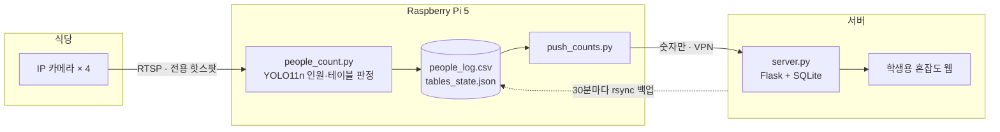

# 밥먹을래말래 · 카메라 기반 학내 식당 실시간 혼잡도 안내

학생 식당에 카메라 4대를 달고, 라즈베리파이 5가 현장에서 YOLO로 **사람 수와 테이블별 사용 여부만 숫자로** 서버에 보냅니다. 서버는 테이블 좌석과 전체 인원을 함께 보고 **지금 혼잡도(여유 · 보통 · 혼잡)** 를 정하고, 지난 평일 기록으로 **시간대별·구역별로 평소 언제 붐비는지** 를 보여줍니다. 영상은 저장하거나 전송하지 않습니다.

| 항목 | 내용 |
|---|---|
| 기간 | 2026년 9월 ~ 11월 (식당 설치 후 평일 시범 운영) |
| 하드웨어 | IP 카메라 4대 (RTSP) · Raspberry Pi 5 · 서버용 Mac mini |
| 기술 | YOLO11n (NCNN) · OpenCV · Flask · SQLite · Tailscale · HTML/CSS/JS |
| 정확도 | 사람 검출 F1 0.77 · 테이블 점유 판정 F1 0.85 (직접 라벨링한 48장 기준) |
| 수상 | 2026 공과대학 학술제 장려상 (4위) |


*학생용 화면을 예시 데이터(`?demo=1`)로 연 모습입니다.*

## 해결하려는 문제

점심시간에는 학생이 한꺼번에 몰리지만, 가기 전에는 얼마나 붐비는지 알 수 없습니다. 학생 식당은 예약이나 좌석 배정이 없어서 실시간 좌석 정보를 얻을 방법도 없습니다. 그래서 두 가지 질문에 답합니다.

1. **"지금 가면 앉을 수 있나?"** → 혼잡 단계, 빈 테이블 수, 키오스크 주문 대기, 자리 배치도
2. **"평소엔 언제 붐비나?"** → 시간대별 오늘 인원과 평소(지난 평일 평균) 비교, 구역별로 가장 붐비는 시간

## 주요 기능

**학생용 웹**

- 지금 혼잡 단계와 빈 테이블 수, 식당 예상 인원, 키오스크 앞 줄로 추정한 주문 대기 시간
- 시간대별 그래프 — 오늘 막대 위에 평소 값을 겹쳐 표시. 전체 / 구역 1~3 / 키오스크 줄을 골라 볼 수 있음
- 구역별로 평소 가장 붐비는 시간과 그때의 좌석 사용률
- 테이블 51곳 자리 배치도 — 사용 중 · 자리 비움 · 빈 자리 · 카메라가 꺼져 측정 안 됨
- 배식대별 영업 상태, 첫 방문 튜토리얼, "실제랑 비슷했나요?" 의견 버튼
- PC · 모바일 반응형, 밝은/어두운 화면

**운영용 화면** (VPN으로 연결된 기기에서만)

- 통계 화면 — 날짜별 방문 · 의견, 테이블별 이용 횟수와 평균 이용 시간, CSV 내려받기
- 현장 관리 화면 — 실시간 카메라와 검출 박스, 집계 구역 · 테이블 영역을 마우스로 그려 등록

## 전체 흐름



1. **카메라 → 라즈베리파이** — 카메라는 라즈베리파이가 직접 띄운 전용 핫스팟에 붙어 RTSP로 영상을 보냅니다. 영상은 외부 네트워크로 나가지 않습니다.
2. **인원 판정** — 카메라마다 최신 프레임을 YOLO11n(입력 1280)에 넣고, **발 위치가 집계 구역 안인 사람만** 셉니다. 영상은 메모리에서만 쓰고 버립니다.
3. **테이블 판정** — 테이블마다 영역을 등록해 두고, 영역 안에 사람이 있으면 "사용 중", 잠깐 비면 "자리 비움", 오래 비면 "빈 자리"로 봅니다.
   - 한 사람은 테이블 하나에만 셉니다 (발이 들어간 테이블 우선, 없으면 몸 중심).
   - 같은 테이블이 여러 카메라에 보이면 하나로 합쳐 판정하고, 보는 카메라가 모두 꺼지면 "측정 안 됨"으로 빼고 계산합니다.
4. **전송** — 5초마다 새 기록과 테이블 상태를 VPN(Tailscale)으로 서버에 보냅니다. 끊기면 보낸 위치를 기억했다가 이어서 보냅니다.
5. **서버** — SQLite에 저장하고 혼잡 단계와 평소 값을 계산합니다. 학생용 화면만 HTTPS로 외부에 공개하고, 통계·관리 화면은 VPN 안에서만 열립니다.

### 혼잡 단계 계산

```
사용 좌석 = max(점유 테이블의 좌석 합, 전체 인원)
남은 비율 = (전체 좌석 − 사용 좌석) / 전체 좌석
```

남은 비율이 30% 이상이면 여유, 10~30%면 보통, 그 아래면 혼잡입니다. "점유 테이블은 통째로 쓴다"와 "서 있는 사람도 곧 앉을 사람이다"를 함께 반영한 식입니다. 자세한 근거와 바뀐 과정은 [docs/혼잡도-계산.md](docs/혼잡도-계산.md), [docs/혼잡도_판단_방식.md](docs/혼잡도_판단_방식.md)에 있습니다.

### 설계 원칙

- **엣지 처리** — 영상은 현장에서 처리하고 숫자만 내보냅니다 (개인정보 보호 + 네트워크 절약).
- **역할 분리** — 라즈베리파이는 "세기", 서버는 "저장 · 판단 · 보여주기".
- **끊겨도 안 잃기** — CSV에 먼저 기록, 이어 보내기, 중복 자동 무시, 30분마다 백업.
- **자동 복구** — 모든 프로그램이 부팅 시 자동 시작하고, 죽으면 자동 재시작 (systemd, launchd).

## 사용 기술

| 분야 | 기술 | 선택 이유 |
|---|---|---|
| 사람 검출 | YOLO11n (Ultralytics), 입력 1280 | 가장 작은 YOLO라 CPU에서 동작. 해상도를 올려 작게 찍힌 사람까지 검출 |
| 모델 실행 | NCNN (실패 시 ONNX + OpenCV DNN) | ARM CPU용 엔진으로 OpenCV DNN보다 약 2배 빠름 |
| 영상 처리 | OpenCV (Python) | RTSP 수신, NMS, 구역·테이블 판정 |
| 엣지 장치 | Raspberry Pi 5 | 카메라 4대를 현장에서 처리하는 저전력 컴퓨터. 피크 3초 / 평소 5초 주기 |
| 서버 | Flask + gunicorn, SQLite (WAL) | 별도 DB 서버 없이 가볍게 운영 |
| 네트워크 | Tailscale, Funnel | 포트 개방 없이 기기 간 연결, 학생용 화면만 HTTPS 공개 |
| 웹 | HTML / CSS / JavaScript | 그래프 라이브러리 없이 직접 그림, 한 파일 |

## 정확도

점심 피크 5분 동안 카메라 4대 화면 400장 중 48장을 직접 라벨링해 비교했습니다 (사람 719명, 테이블 575칸).

| 항목 | 결과 | 의미 |
|---|---|---|
| 사람 검출 | 정밀도 0.99 · 재현율 0.64 · F1 0.77 | 잘못 잡는 일은 거의 없지만, 가려지거나 작게 찍힌 사람을 놓침 |
| 테이블 점유 판정 | 재현율 0.96 · F1 0.85 | 사용 중인 테이블은 거의 다 잡음. 오류는 빈 테이블을 사용 중으로 보는 쪽이라 실제보다 붐비게 안내 |

혼잡 단계는 테이블 좌석 기준이라 사람을 놓치는 영향이 작습니다. 이후 "한 사람은 테이블 하나에만" 규칙을 넣어 빈 테이블을 사용 중으로 보는 오류를 줄이는 중이고, 새 모델(YOLO26n)과의 비교도 같은 프레임으로 기록하고 있습니다 ([pi/compare_shadow.py](pi/compare_shadow.py)).

## 저장소 구성

```text
├── pi/                        라즈베리파이에서 도는 코드
│   ├── people_count.py        카메라 수신 → YOLO 인원 계산 → 테이블 판정 → 기록, 현장 관리 화면
│   ├── push_counts.py         기록을 서버로 5초마다 전송
│   ├── compare_shadow.py      YOLO11n과 YOLO26n 비교 기록 요약
│   ├── tables.json            테이블 영역 (관리 화면에서 저장한 값)
│   └── zones.json             카메라별 집계 구역
├── cafeteria-server/          서버와 학생용 웹
│   ├── server.py              데이터 받기·저장, 혼잡 판단, 평소 값·구역별 예측, 통계 (API)
│   ├── index.html             학생용 혼잡도 화면 (한 파일)
│   ├── layout.html / .json    자리 배치도 편집기와 배치 데이터
│   ├── import_table_log.py    라즈베리파이 테이블 기록을 서버 DB로 옮기기
│   ├── bench_ncnn.py          NCNN과 OpenCV DNN 속도 비교
│   ├── backup_pi.sh           라즈베리파이 기록 백업 (rsync)
│   └── launchd/               서버·백업 자동 실행 설정 (macOS)
└── docs/                      혼잡도 계산 방법과 바뀐 과정
```

## 직접 돌려 보기

화면만 보려면 `cafeteria-server/index.html`을 브라우저로 열고 주소 끝에 `?demo=1`을 붙이면 예시 데이터로 동작합니다.

실제로 돌리려면:

1. **라즈베리파이** — `people_count.py`의 `CAMS`에 카메라 주소와 RTSP 계정을 넣고, YOLO11n을 1280 입력으로 NCNN 변환한 모델을 같은 폴더에 둡니다. `python3 people_count.py`로 실행한 뒤 `:5000/tables`에서 테이블 영역을 그립니다.
2. **서버** — `cafeteria-server/`에 `token.txt`(라즈베리파이 `~/.push_token`과 같은 값)를 두고, `server.py`의 `ALLOWED_INGEST`에 라즈베리파이 주소를 넣은 뒤 `gunicorn -w 1 --threads 4 -b 0.0.0.0:8000 server:app`으로 실행합니다.
3. **전송** — 라즈베리파이 `push_counts.py`의 `SERVER`에 서버 주소를 넣고 실행합니다.

카메라 주소, 계정, 토큰 같은 값은 저장소에 넣지 않고 `<cam1 IP>` 같은 자리 표시로 비워 두었습니다.

## 한계

- 테이블 판정은 "영역 안에 사람이 있는가"로만 정합니다. 줄을 서거나 지나가는 사람이 영역을 스치면 잠깐 사용 중으로 보일 수 있습니다.
- 위에서 내려다보는 각도라 가려진 사람을 놓치기도 하고, 카메라 밖 좌석은 집계하지 않습니다.
- "평소" 값은 지난 평일 같은 시간대 평균이라, 시험 기간이나 행사처럼 평소와 다른 날은 맞지 않습니다.
